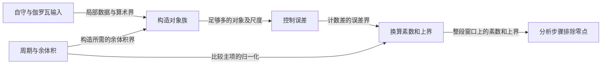

# 读图：为什么素数和的上界会限制零点？

设想在临界线右侧发现一个零点，比如 $s=0.6+it$。这份候选证明的目标是推出矛盾。它不直接估算 $L(s,\chi)$ 的数值，而是把这个零点和一个加权的素数和联系起来。如果能证明这个和的某种组合增长得足够慢，就能排除该零点。困难在于，这个上界是从一组专门构造的算术对象间接得到的。

下文的「尺度」指素数和的截断点 $x$，和候选零点的虚部 $t$ 是不同的变量。特征 $\chi$ 给不同同余类里的整数分配权重。最简单的例子见[分析背景](background/01-analysis.md)。先理解这两个量，读第一遍时可以暂时把「专门构造的对象」当作一个待填的数学任务。

## 一条读者可以追到底的路线

图中每个箭头表示前一块应当交给后一块的东西。读者可以先从右侧的零点问题往左找，看看还需要什么。

1. **先定目标。** [第 1 章](01-analytic.md)问：给我怎样的素数和上界，我就能保证 $0.6+it$ 不是零点？关键是把加权素数和用积分变换写成复函数。零点对应的极点，在实际使用的窗口论证中会迫使上界在某处失效。
2. **倒推要估计的量。** [第 2 章](02-comparison.md)从分析所需的上界往前走。源码先控制一个把两类贡献相减得到的量 `gapA`，再把它换算成素数和的估计。这个换算有额外项，也有适用尺度的条件。
3. **把误差和主项分开检查。** [第 3 章](03-errors.md)追误差怎样累积以及为何还能逼近平方根指数。[第 4 章](04-periods.md)处理公式两边是否在用同一种度量。即使误差很小，主项若差一个随 $x$ 变化的归一化因子，上界也不能直接使用。
4. **检查对象真的能造出来。** [第 5 章](05-families.md)问：给定要排除零点的特征，怎样得到满足前述条件的对象族？[第 6 章](06-automorphic.md)解释这个构造从自守与伽罗瓦理论取得的输入。读到这些章节再补[格、局部与整体](background/02-arithmetic.md)和[自守与伽罗瓦背景](background/03-automorphic.md)。

把顺序倒过来，就是候选证明尝试走的路：先为指定特征构造对象族，再用它估计素数和，最后排除零点。分章讲解时可以暂时接受上游命题，合并时必须核对它的完整假设有没有被兑现。

## 用 $0.6+it$ 做一次读图练习

用 $\beta$ 表示素数和上界中的增长指数。若分析步骤允许用 $\beta=0.55$，就有 $0.55<0.6$，因此可以排除这个点。若只得到 $\beta=0.7$，结论是「实部大于 $0.7$ 的区域无零」，对这个点没有帮助。原稿的一个窗口估计形如 $x^{1/2+(e_D+e_L+7)\varepsilon}$。关键是先固定两个常数，再为当前零点选择足够小的 $`\varepsilon`$。只说「令 $`\varepsilon`$ 趋零」会漏掉对象族也必须随这个选择存在的条件。[窗口估计和参数选择的源码](https://github.com/leanprover-community/riemann-hypothesis/blob/40e56bab026552e089d7afcfeff08d2defb9c005/src/Formalism/SharpRestriction/RamificationFrobenius/TotientGaloisClasses/TopWin.lean#L25)

另一个问题是 $x$ 从哪里取。如果上界只在 $x=2^{2^n}$ 这些离散的点成立，仍然不能使用原稿的窗口论证。原稿要求的是：无论给多大的起点下限，都能在它后面找到一个 $Y$，使上界在**整个**区间 $[Y,Y^{3/2}]$ 上成立。窗口之间可以有空档。这与处处成立、或只在一列点上成立，都有区别。第 2、3、5 章会分别解释估计、窗口和构造如何衔接。

读完后可以反过来问自己：给你 $s=0.501+it$，上界指数应选在哪个区间？接下来还必须确认什么？应选在 $1/2$ 和 $0.501$ 之间，还要检查对象族存在、窗口有效，并且估计适用于含目标特征的组合。

## 读到这些符号时

| 符号 | 在主线里是什么 |
|---|---|
| $s=\sigma+it$ | 候选零点，$`\sigma`$ 是实部。 |
| $x,Y,\lambda$ | 截断尺度、窗口左端和窗口指数。主路线取 $\lambda=3/2$。 |
| $\beta,\varepsilon$ | $\beta$ 是分析步骤允许的上界指数，源码这里写作 `θ`。$`\varepsilon`$ 是构造与估计用的可选小参数。 |
| $\chi,\psi$ | 特征。分析章常写 $\chi$，对象族的入口常写 $\psi$。 |
| $\Lambda(n)$、`Level` | 前者是给素数幂加权的函数，后者是组织有限特征组合的数据。源码有时也用字母 $\Lambda$ 表示后一种对象。 |

## 怎样读证据

「源码路径」表示已在固定版源码中看到相应声明或调用。「局部 Lean 检查」只用于实际重跑的少数推导。「待追」表示讲解在这里使用一个尚未独立重建的接口。函数名相同、能在文件里找到引理、以及已经重建它的数学含义，分别是不同程度的证据。[版本与证据范围](../SOURCES.md)
